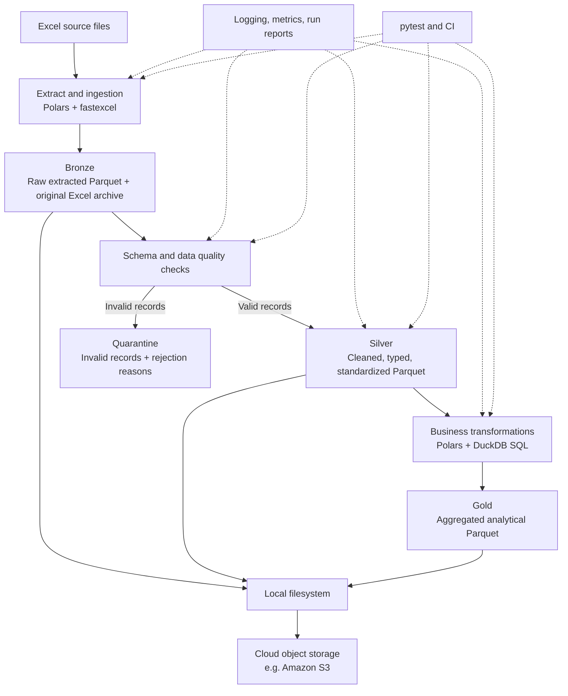

# Minimal Data Engineering Pipeline — Learning & Implementation Roadmap - Claude

https://claude.ai/chat/e0c33bcb-65cd-4af6-881a-f89f6614f713


## 1. Project goal: Build a minimal Data Engineering pipeline

Build a **small batch data lakehouse using Python, Polars, Parquet, and DuckDB**.

The goal is not to build a production-scale platform immediately. It is to understand the complete data lifecycle:

1. Extract data from Excel.
2. Convert it into Parquet.
3. Store original and extracted data in Bronze.
4. Validate data quality.
5. Clean and standardize data.
6. Store cleaned data in Silver.
7. Transform and aggregate data.
8. Store analytical datasets in Gold.
9. Connect to cloud object storage.
10. Implement logging, monitoring, testing, and basic automation.

At the end, you should be able to explain what happens to data at every stage, why it happens, and how to identify failures.

### 1.1. Recommended architecture



This follows the common **Medallion Architecture** principle: Bronze is raw ingestion, Silver is cleaned and validated data, and Gold is aggregated and business-ready data.

A key design point: validation happens at more than one point. Perform basic file/schema checks before or during ingestion, row-level data-quality checks when preparing Silver, and output/business-rule checks after transformations. Do not wait until Gold to discover invalid source data.

Also, do not confuse the layers with physical services. Bronze, Silver, and Gold can simply be separate directories containing Parquet files. You do not need Spark, a data warehouse, or a complex cloud platform to learn the architecture.

### 1.2. Recommended technology stack

| Responsibility | Tool | Why |
|---|---|---|
| Main language | Python | Pipeline logic and integration |
| Excel reading | Polars + fastexcel | Read worksheets |
| Columnar storage | Parquet | Standardized analytical storage |
| Data processing | Polars | Cleaning and transformations |
| SQL analytics | DuckDB | Query Parquet with SQL and aggregate |
| Local storage | Filesystem | Simple data lake structure |
| Validation | Python + pytest | Schema and business-rule checks |
| Logging | Python `logging` | Execution records |
| Cloud | AWS S3 | Object storage |
| Automation | CLI initially | Explicit sequential execution |
| CI/CD | GitHub Actions | Automatically run tests |
| Documentation | Markdown | Architecture and data contracts |

Suggested responsibilities:

- **Polars:** read Excel, manipulate DataFrames, clean data, and write Parquet.
- **DuckDB:** query Parquet with SQL, join analytical datasets, and calculate business metrics.

You can use both without introducing another processing framework.

Useful references:

- [Polars Excel guide](https://docs.pola.rs/user-guide/io/excel/)
- [Polars Parquet guide](https://docs.pola.rs/user-guide/io/parquet/)
- [DuckDB Python API](https://duckdb.org/docs/stable/clients/python/overview)

---

## 2. Define your MVP before writing code

Do not start with 20 Excel templates, 300 sheets, millions of rows, or cloud infrastructure. Build one small business scenario first.

### 2.1. Recommended sample dataset

Use a simple sales/order dataset.

| Column | Type | Business rule |
|---|---|---|
| `order_id` | String | Required, unique |
| `order_date` | Date | Required, valid date |
| `customer_id` | String | Required |
| `region` | String | Required, allowed region |
| `quantity` | Integer | Greater than zero |
| `unit_price` | Decimal | Zero or greater |
| `status` | String | Allowed status values |

Create one Excel workbook:

```text
sales.xlsx
  └── orders
        ├── order_id
        ├── order_date
        ├── customer_id
        ├── region
        ├── quantity
        ├── unit_price
        └── status
```

Start with approximately 1,000–5,000 rows.

Intentionally introduce bad data:

- Missing `order_id`.
- Duplicate `order_id`.
- Invalid date.
- Negative quantity.
- Missing customer.
- Invalid region.
- Unexpected order status.

A dataset containing only perfect data will not teach much about data engineering.

### 2.2. What each layer should contain

| Layer | Example output | Responsibility |
|---|---|---|
| Source | `sales.xlsx` | Original source |
| Bronze | `orders.parquet` | Extracted source data |
| Silver | `orders.parquet` | Clean, typed, validated records |
| Gold | `sales_daily.parquet` | Revenue and order aggregations |
| Quarantine | `invalid_orders.parquet` | Invalid records and rejection reasons |
| Observability | `run_report.json` | Execution and quality information |

A possible directory structure:

```text
data-platform/
│
├── data/
│   ├── source/
│   │   └── sales.xlsx
│   ├── bronze/
│   │   └── orders/
│   │       └── orders.parquet
│   ├── silver/
│   │   └── orders/
│   │       └── orders.parquet
│   ├── gold/
│   │   └── sales_daily/
│   │       └── sales_daily.parquet
│   ├── quarantine/
│   │   └── orders/
│   │       └── invalid_orders.parquet
│   └── reports/
│       └── run_report.json
│
├── configs/
│   └── pipeline.yaml
├── src/
│   └── data_platform/
│       ├── extraction/
│       │   └── excel_reader.py
│       ├── bronze/
│       │   └── bronze_writer.py
│       ├── validation/
│       │   └── validators.py
│       ├── silver/
│       │   └── cleaning.py
│       ├── gold/
│       │   └── aggregation.py
│       ├── storage/
│       │   └── local_storage.py
│       ├── monitoring/
│       │   ├── logger.py
│       │   └── metrics.py
│       ├── pipeline.py
│       └── cli.py
├── tests/
│   ├── unit/
│   ├── integration/
│   └── fixtures/
├── logs/
├── pyproject.toml
├── .env.example
├── .gitignore
└── README.md
```

Do not create empty modules for everything on day one. Create them as you implement the corresponding stages.

---

## 3. Complete implementation roadmap

There are 12 implementation stages. The first eight build the actual data pipeline; the remaining stages make it more reliable, observable, and deployable.

## Stage 0 — Understand the source and define the data contract

**Objective:** Know what your input data means before processing it.

### Tasks

- [ ] Select one Excel workbook.
- [ ] Select one worksheet.
- [ ] Inspect its header and sample rows.
- [ ] Identify required and optional columns.
- [ ] Define the data type of each column.
- [ ] Define primary/business keys.
- [ ] Define null-handling rules.
- [ ] Define valid values and business constraints.
- [ ] Decide what makes a record invalid.
- [ ] Define expected outputs for Silver and Gold.

Example data contract:

```yaml
dataset: orders

source:
  file: sales.xlsx
  sheet: orders

business_key:
  - order_id

columns:
  order_id:
    type: string
    nullable: false

  order_date:
    type: date
    nullable: false

  customer_id:
    type: string
    nullable: false

  quantity:
    type: integer
    nullable: false
    minimum: 1

  unit_price:
    type: decimal
    nullable: false
    minimum: 0
```

This YAML is illustrative; a Python dictionary is sufficient initially.

### Knowledge to learn

| Topic | What to understand |
|---|---|
| Data types | String, integer, decimal, date, datetime, null |
| Excel structure | Workbook, worksheet, header, cell, formula |
| Data schema | Column name, type, nullable, constraints |
| Business key | Primary key and composite key |
| Data contract | Expectations between data producer and consumer |
| Data quality | Completeness, uniqueness, validity, consistency |

**Tools:** Excel, Python, Polars, YAML.

**Testing:** Verify the source file actually conforms to the schema you documented.

**Security:** Identify whether the sample contains personal or confidential information. Use synthetic data for the portfolio.

**Deliverable:** A source-data specification and sample Excel workbook.

## Stage 1 — Extract Excel data

**Objective:** Read Excel data into a Python DataFrame without accidentally changing its meaning.

### Tasks

- [ ] Find Excel files in the source directory.
- [ ] Exclude temporary Excel files such as `~$sales.xlsx`.
- [ ] Read the selected worksheet.
- [ ] Inspect the discovered schema.
- [ ] Check missing and unexpected columns.
- [ ] Capture the source filename.
- [ ] Capture the worksheet name.
- [ ] Capture the ingestion timestamp.
- [ ] Handle unreadable or corrupted workbooks.

Example:

```python
import polars as pl

df = pl.read_excel(
    "data/source/sales.xlsx",
    sheet_name="orders",
    engine="calamine",
)

print(df.schema)
print(df.head())
print(df.shape)
```

Read the [Polars Excel guide](https://docs.pola.rs/user-guide/io/excel/) first. It explains the available Excel engines and their trade-offs.

### Knowledge to learn

| Topic | What to understand |
|---|---|
| Python file handling | `pathlib`, file extensions, file existence |
| Excel I/O | Excel reader engines and worksheet selection |
| DataFrames | Schema, rows, columns, expressions |
| Type inference | How values become strings, numbers, dates |
| Error handling | Exceptions, invalid input files |
| Memory | Difference between reading and processing a whole workbook |

### Other aspects

**Testing**

- Valid workbook.
- Missing worksheet.
- Empty worksheet.
- Duplicate headers.
- Corrupted workbook.
- Unexpected column.

**Security**

- Do not trust a filename or extension alone.
- Never execute macros from uploaded files.
- Do not use arbitrary file paths supplied by an untrusted user.

**Excel-specific consideration:** Excel cell values and displayed formatting are not necessarily the same. Preserve the original workbook so you can investigate extraction problems. For color-coded template requirements, inspect cell styles separately using OpenPyXL; do not expect an ordinary DataFrame reader to understand the business meaning of header colors.

**Deliverable:** `excel_reader.py` returns a DataFrame and source metadata.

## Stage 2 — Convert and store data in Bronze

**Objective:** Produce a Parquet representation of the extracted data with minimal transformation.

### Tasks

- [ ] Create the Bronze directory.
- [ ] Write the DataFrame to Parquet.
- [ ] Add ingestion metadata.
- [ ] Preserve the original Excel workbook.
- [ ] Verify the created Parquet file.
- [ ] Read it back to verify basic consistency.

Suggested metadata:

```text
source_file
source_sheet
ingestion_timestamp
run_id
source_row_number
```

Example:

```python
import polars as pl

df = df.with_row_index("source_row_number")

df = df.with_columns(
    pl.lit("sales.xlsx").alias("source_file"),
    pl.lit("orders").alias("source_sheet"),
)

df.write_parquet(
    "data/bronze/orders/orders.parquet"
)
```

This is illustrative; attach the actual run timestamp and run ID in your pipeline.

### Knowledge to learn

| Topic | What to understand |
|---|---|
| Parquet | Columnar storage |
| Compression | Compression algorithms and storage trade-offs |
| Schema | Data types inside Parquet |
| Metadata | Schema and file metadata |
| Partitioning | Organizing files by dates or other dimensions |
| Data lineage | Where the data came from |

Read:

- [Apache Parquet file format specification](https://parquet.apache.org/docs/file-format/)
- [Polars Parquet guide](https://docs.pola.rs/user-guide/io/parquet/)

### Other aspects

**Testing**

- File exists.
- File is readable.
- Row count is preserved.
- Required columns exist.
- Source metadata is populated.

**Reliability**

- Avoid silently overwriting previous successful runs.
- Keep the source workbook unchanged.
- Record which source file produced each dataset.

**Deliverable:** Original Excel archived and Bronze Parquet created.

## Stage 3 — Validate data quality

**Objective:** Identify invalid records and decide how the pipeline should handle them.

Separate validation into two categories.

### A. Dataset/schema-level validation

| Validation | Example |
|---|---|
| Required columns | `order_id` exists |
| Duplicate headers | No duplicate column names |
| Missing worksheet | `orders` must exist |
| Expected schema | Expected column types or convertible values |
| Empty dataset | Reject unexpected empty input |

These failures can block ingestion or prevent the dataset from being published.

### B. Row-level validation

| Validation | Example |
|---|---|
| Not null | `order_id` cannot be null |
| Unique | `order_id` must be unique |
| Type | `quantity` must be an integer |
| Range | `quantity > 0` |
| Domain | `status` must be an allowed value |
| Business rule | `unit_price >= 0` |

For row-level errors, create two DataFrames:

```text
Input Bronze data
       |
       v
   Validation
     /     \
    /       \
 Valid     Invalid
   |          |
   v          v
 Silver    Quarantine
```

Your quarantine dataset should contain the original invalid values and a reason for rejection.

Example:

| order_id | quantity | validation_error |
|---|---:|---|
| A001 | -5 | quantity_must_be_positive |
| null | 2 | order_id_required |
| A003 | 0 | quantity_must_be_positive |

Do not silently delete invalid records.

### Tasks

- [ ] Implement required-column checks.
- [ ] Implement null checks.
- [ ] Implement uniqueness checks.
- [ ] Implement type-conversion checks.
- [ ] Implement range checks.
- [ ] Implement allowed-value checks.
- [ ] Implement business-rule checks.
- [ ] Separate valid and invalid records.
- [ ] Generate a validation report.
- [ ] Decide which failures block the pipeline.

### Knowledge to learn

- Data quality dimensions.
- Schema validation.
- Data contracts.
- Referential integrity.
- Primary and composite keys.
- Null semantics.
- Validation versus transformation.
- Fail-fast versus quarantine.
- Error classification and reporting.

**Tools:** Python, Polars, pytest. Later, investigate [Pandera](https://pandera.readthedocs.io/en/stable/) or [Great Expectations](https://docs.greatexpectations.io/) rather than installing several validation frameworks immediately.

**Testing:** Create good and bad sample records for every rule.

**Deliverable:** Valid DataFrame, invalid DataFrame, and a machine-readable validation report.

## Stage 4 — Clean and transform data into Silver

**Objective:** Convert source data into a consistent and usable dataset.

Bronze should preserve the original extracted representation. Silver should contain standardized data.

### Tasks

- [ ] Rename columns into a consistent naming convention.
- [ ] Remove unnecessary whitespace.
- [ ] Normalize empty strings and null representations.
- [ ] Parse dates and datetimes.
- [ ] Convert numeric fields.
- [ ] Standardize region and status values.
- [ ] Handle duplicate business keys according to a documented rule.
- [ ] Apply business transformations.
- [ ] Retain only valid records.
- [ ] Write Silver Parquet.
- [ ] Revalidate the Silver output.

Example:

```python
import polars as pl

silver_df = (
    bronze_df
    .with_columns(
        pl.col("region").str.strip_chars(),
        pl.col("customer_id").str.strip_chars(),
        pl.col("order_date").str.to_date(
            format="%Y-%m-%d",
            strict=False,
        ),
        pl.col("quantity").cast(
            pl.Int64,
            strict=False,
        ),
    )
)
```

This is a demonstration, not complete cleaning logic. Check conversion failures rather than allowing `strict=False` to hide them.

### Knowledge to learn

| Topic | What to understand |
|---|---|
| Data cleaning | Null handling, whitespace, duplicates |
| Type casting | Explicit and implicit conversions |
| Date processing | Date parsing, timezone, formats |
| Transformations | Filter, select, join, derive columns |
| Business logic | Rules that define a valid business record |
| Idempotency | Re-running transformations safely |
| Schema evolution | How changing source columns affects outputs |

### Other aspects

**Testing**

- Silver has the expected schema.
- Required fields are non-null.
- Business keys are unique.
- No invalid business values remain.
- Cleaning does not unexpectedly remove valid records.

**Data governance:** Maintain definitions for cleaned columns. Document any field that changes meaning. Do not delete source information without a reason.

**Deliverable:** A clean, standardized, typed Silver Parquet dataset.

## Stage 5 — Transform Silver into Gold

**Objective:** Create analytical datasets that answer business questions.

Silver contains detailed records. Gold contains datasets designed for specific analytical purposes.

For this project, create `sales_daily.parquet`. Its grain is one record per business date and region.

Example:

| order_date | region | order_count | total_quantity | revenue |
|---|---|---:|---:|---:|
| 2026-01-01 | North | 15 | 42 | 1200.50 |
| 2026-01-01 | South | 20 | 58 | 1800.00 |
| 2026-01-02 | North | 12 | 31 | 950.00 |

### Tasks

- [ ] Define the business question.
- [ ] Define the aggregation grain.
- [ ] Identify the dimensions.
- [ ] Identify the measures.
- [ ] Write aggregation logic.
- [ ] Perform joins if necessary.
- [ ] Verify aggregation results.
- [ ] Write Gold Parquet.
- [ ] Query and inspect Gold using DuckDB.

Example DuckDB query:

```sql
SELECT
    order_date,
    region,
    COUNT(*) AS order_count,
    SUM(quantity) AS total_quantity,
    SUM(quantity * unit_price) AS revenue
FROM read_parquet('data/silver/orders/orders.parquet')
GROUP BY
    order_date,
    region
ORDER BY
    order_date,
    region;
```

### Knowledge to learn

- SQL `SELECT`, `WHERE`, `GROUP BY`, `ORDER BY`.
- Aggregate functions.
- JOIN types.
- CTEs.
- Window functions (later).
- Dimensional modeling.
- Fact tables and dimension tables.
- Grain.
- Measures and dimensions.
- Business metrics.

DuckDB can query Parquet directly, including through its Python API, so you do not need to load everything into a separate database first.

### Other aspects

**Testing:** The most important test here is reconciliation:

```text
Total Silver revenue = Total Gold revenue
```

This assumes the same business filters and rounding rules. Also verify that each date-region combination appears only once.

**Deliverable:** At least one Gold analytical dataset with tested business calculations.

## Stage 6 — Organize and manage local storage

**Objective:** Understand how a data lake stores multiple datasets and processing runs.

### Tasks

- [ ] Separate Source, Bronze, Silver, Gold, and Quarantine.
- [ ] Define naming conventions.
- [ ] Define dataset naming conventions.
- [ ] Decide how each run is stored.
- [ ] Keep previous outputs available for debugging.
- [ ] Avoid overwriting data that is still being processed.
- [ ] Store a run manifest.

Example structure after a few runs:

```text
data/
├── bronze/
│   └── orders/
│       ├── run_001/
│       └── run_002/
├── silver/
│   └── orders/
│       ├── run_001/
│       └── run_002/
└── gold/
    └── sales_daily/
        ├── run_001/
        └── run_002/
```

For this first version, do not implement sophisticated partitioning, incremental ingestion, CDC, or historical merge operations.

### Knowledge to learn

- Data lake versus data warehouse.
- File-based data storage.
- Object storage versus filesystem.
- File naming and organization.
- Partitioning.
- Data retention.
- Storage formats.
- Basic backup and recovery.
- Idempotent execution.

**Deliverable:** A consistent local data lake layout.

## Stage 7 — Add cloud object storage

**Objective:** Store the same datasets in cloud storage.

Start with **Amazon S3**. It lets you learn object storage, cloud permissions, SDK integration, and cloud data access without introducing another processing engine.

### Tasks

- [ ] Understand bucket and object concepts.
- [ ] Create an S3 bucket.
- [ ] Configure private access.
- [ ] Configure AWS credentials locally.
- [ ] Create an S3 storage module.
- [ ] Upload Bronze Parquet.
- [ ] Upload Silver Parquet.
- [ ] Upload Gold Parquet.
- [ ] Upload the run manifest.
- [ ] List and inspect uploaded files.
- [ ] Download a Parquet file and verify its contents.
- [ ] Test cloud upload failures.

Suggested layout:

```text
s3://my-data-platform/
├── bronze/
│   └── orders/
├── silver/
│   └── orders/
├── gold/
│   └── sales_daily/
├── quarantine/
│   └── orders/
└── metadata/
    └── runs/
```

Use Python Boto3's `upload_file()` initially rather than building a sophisticated direct cloud-writing system. See the [Boto3 S3 documentation](https://boto3.amazonaws.com/v1/documentation/api/latest/guide/s3.html).

### Knowledge to learn

| Topic | What to understand |
|---|---|
| Cloud computing | IaaS, PaaS, SaaS |
| Object storage | Bucket, object, key, prefix |
| S3 | Upload, download, list, delete |
| IAM | Identity, role, policy, permission |
| SDK | Boto3 and API communication |
| Environment | Credentials and configuration |
| Networking | HTTPS, endpoints, timeouts |
| Cost | Storage and request charges |

### Security requirements

- Keep buckets private.
- Enable S3 Block Public Access.
- Follow least privilege for IAM permissions.
- Never hard-code AWS credentials.
- Never commit `.env` or access keys.
- Do not log secret keys, tokens, or sensitive data.
- Use encryption in transit and at rest.
- Use a separate test bucket or prefix.

Read [AWS S3 security best practices](https://docs.aws.amazon.com/AmazonS3/latest/userguide/security-best-practices.html).

### Important architectural decision

For now, implement:

```text
Excel
  ↓
Local processing
  ↓
Local Parquet
  ↓
Upload to S3
```

Do not immediately make every Polars operation read and write directly to S3. That adds cloud configuration and network problems to what should initially be a data-processing learning exercise.

Later, investigate direct cloud access through [Polars cloud storage support](https://docs.pola.rs/user-guide/io/cloud-storage/).

**Deliverable:** One successful pipeline run with Bronze, Silver, and Gold uploaded to S3 and verified.

## Stage 8 — Logging and observability

**Objective:** Understand what happened during every pipeline execution and identify where and why failures occurred.

This is different from simply printing messages. Build two separate capabilities.

### A. Logging

Logging records events.

Example:

```text
2026-11-03 10:00:00 INFO Pipeline started
2026-11-03 10:00:01 INFO Reading sales.xlsx
2026-11-03 10:00:02 INFO Extracted 1000 rows
2026-11-03 10:00:03 INFO Bronze created
2026-11-03 10:00:04 WARNING 10 invalid records found
2026-11-03 10:00:05 INFO Silver created
2026-11-03 10:00:06 INFO Gold created
2026-11-03 10:00:07 INFO Pipeline completed
```

Learn:

- Python `logging`.
- Log levels: DEBUG, INFO, WARNING, ERROR, CRITICAL.
- Logging format.
- File logging.
- Exception logging.
- Structured logging (later).

Start with [Python's Logging HOWTO](https://docs.python.org/3/howto/logging.html).

### B. Observability

Observability helps you understand the internal state and behavior of your pipeline.

Create a JSON run report:

```json
{
  "run_id": "run_001",
  "status": "SUCCESS",
  "source_file": "sales.xlsx",
  "started_at": "2026-11-03T10:00:00",
  "finished_at": "2026-11-03T10:00:07",
  "stages": {
    "extract": {
      "status": "SUCCESS",
      "rows_read": 1000
    },
    "bronze": {
      "status": "SUCCESS",
      "rows_written": 1000
    },
    "validation": {
      "status": "SUCCESS",
      "valid_rows": 990,
      "invalid_rows": 10
    },
    "silver": {
      "status": "SUCCESS",
      "rows_written": 990
    },
    "gold": {
      "status": "SUCCESS",
      "rows_written": 20
    }
  }
}
```

First observability metrics:

| Metric | Why |
|---|---|
| Execution status | Did the pipeline succeed? |
| Duration per stage | Which stage is slow? |
| Input row count | How much data was received? |
| Output row count | How much data was produced? |
| Rejected row count | How much data was invalid? |
| Null count | Are there missing values? |
| Duplicate count | Are business keys duplicated? |
| Output file size | How much storage is being used? |
| Error count | Did processing encounter problems? |

### Tasks

- [ ] Generate a unique `run_id`.
- [ ] Record pipeline start and end time.
- [ ] Log every major stage.
- [ ] Capture exceptions.
- [ ] Measure stage execution duration.
- [ ] Count rows entering and leaving every layer.
- [ ] Create `run_report.json`.
- [ ] Store logs and run reports separately.
- [ ] Track failed stages.

### Knowledge to learn

- Logging versus monitoring versus observability.
- Metrics versus logs versus traces.
- Counters, gauges, histograms.
- Execution context and correlation IDs.
- Error tracking.
- Data lineage.
- Pipeline health.
- Alerting.

Later, study [OpenTelemetry for Python](https://opentelemetry.io/docs/languages/python/). Do not start with Prometheus, Grafana, Jaeger, and OpenTelemetry simultaneously.

**Deliverable:** Every pipeline execution generates a run report and useful logs, including failed executions.

## Stage 9 — Testing and quality assurance

**Objective:** Ensure that your pipeline works correctly, not just that it can execute successfully.

Think of each pipeline stage as a component with defined inputs, outputs, and expected behavior.

### A. Unit testing

Test one individual function.

| Function | Test |
|---|---|
| `read_excel()` | Returns expected columns |
| `validate_schema()` | Detects missing column |
| `check_unique()` | Detects duplicate ID |
| `clean_region()` | Removes unexpected whitespace |
| `parse_date()` | Handles invalid date |
| `aggregate_sales()` | Returns correct revenue |

### B. Integration testing

Test multiple stages together:

```text
Excel → Extract → Bronze → Validation → Silver → Gold
```

Check that outputs from one stage are suitable inputs for the next.

### C. End-to-end testing

Run the complete pipeline using a sample workbook.

Verify:

- All expected files are created.
- Row counts are consistent.
- Invalid data is quarantined.
- Silver follows its schema.
- Gold calculations are correct.
- The run report reflects the actual result.

### Suggested test cases

| ID | Scenario | Expected result |
|---|---|---|
| TC01 | Valid Excel input | Pipeline succeeds |
| TC02 | Missing worksheet | Extraction fails |
| TC03 | Missing required column | Schema check fails |
| TC04 | Null business key | Record rejected |
| TC05 | Duplicate key | Record rejected or handled by defined rule |
| TC06 | Invalid date | Record rejected |
| TC07 | Negative quantity | Record rejected |
| TC08 | Empty worksheet | Correctly handled |
| TC09 | Cloud upload failure | Pipeline reports failure |
| TC10 | Same input executed twice | No unintended duplicate output |
| TC11 | Parquet file corrupted | Read failure reported |
| TC12 | Gold revenue | Matches independently calculated expected value |

### Knowledge to learn

- pytest.
- Fixtures.
- Parametrization.
- Mocking.
- Unit and integration testing.
- Test data management.
- Regression testing.
- Test coverage.
- Data reconciliation.
- Failure recovery.

Study [pytest fixtures](https://docs.pytest.org/en/stable/how-to/fixtures.html) and `tmp_path`, which allow tests to create isolated temporary files without touching your real data directory.

**Deliverable:** A test suite that can independently verify the entire pipeline.

## Stage 10 — Build a simple CLI and execution interface

**Objective:** Make the pipeline easy to execute without opening and manually running each Python file.

Do not build a web application yet. Create one entry point:

```bash
python -m data_platform.cli run \
    --input data/source/sales.xlsx
```

The CLI calls your pipeline:

```python
def run_pipeline(config):
    source = extract_excel(config)

    bronze = write_bronze(source, config)

    valid, invalid, report = validate_data(
        bronze,
        config,
    )

    silver = build_silver(valid, config)

    gold = build_gold(silver, config)

    save_quarantine(invalid, config)

    publish_outputs(config)

    return report
```

This is conceptual orchestration. The real implementation should also record the run report, handle failures, and avoid publishing incomplete results.

### Tasks

- [ ] Create CLI arguments.
- [ ] Support input file selection.
- [ ] Support configuration file selection.
- [ ] Add a run ID.
- [ ] Return a non-zero exit code when appropriate.
- [ ] Print a useful summary.
- [ ] Support a local-only run.

### Knowledge to learn

- Python modules and packages.
- `argparse` or [Typer](https://typer.tiangolo.com/).
- Command-line arguments.
- Environment variables.
- Configuration management.
- Exit codes.
- Dependency injection basics.

**Deliverable:** One command runs the complete pipeline.

## Stage 11 — CI/CD and automation

**Objective:** Automatically verify that your project still works after code changes.

Use GitHub Actions. Your first CI workflow should:

```text
Push code
    ↓
Install Python dependencies
    ↓
Run Ruff
    ↓
Run pytest
    ↓
Publish test results
```

### Tasks

- [ ] Create GitHub repository.
- [ ] Configure `.gitignore`.
- [ ] Pin your dependencies.
- [ ] Configure Ruff.
- [ ] Configure GitHub Actions.
- [ ] Run unit tests automatically.
- [ ] Run integration tests using local fixtures.
- [ ] Check code formatting.
- [ ] Keep cloud credentials out of CI initially.

Later, add deployment or cloud-upload testing using a separate test environment.

Learn:

- Git branching.
- Pull requests.
- GitHub Actions.
- CI versus CD.
- Environment variables and secrets.
- Build/test automation.
- Dependency management.
- Version pinning.

Reference: [GitHub Actions — Building and testing Python](https://docs.github.com/en/actions/tutorials/build-and-test-code/python).

**Deliverable:** Every push triggers automated code-quality and test checks.

## Stage 12 — Add orchestration and scheduling

**Objective:** Understand how to automatically coordinate pipeline stages and schedule executions.

Your current `run_pipeline()` function is already a simple sequential orchestration mechanism.

Later, research **[Prefect](https://docs.prefect.io/)** first.

Why:

- It works with Python functions.
- It introduces flow and task concepts.
- It supports execution tracking.
- It provides scheduling and retries.
- It lets you learn orchestration without immediately adopting a complex distributed processing system.

Another option is [Dagster](https://dagster.io/). Its asset-oriented design is useful when you start thinking about data lineage and dependencies.

### Tasks for the later version

- [ ] Understand DAG concepts.
- [ ] Understand tasks and dependencies.
- [ ] Convert pipeline stages into tasks or assets.
- [ ] Configure retries.
- [ ] Configure execution timeouts.
- [ ] Schedule daily execution.
- [ ] Track failed and successful runs.
- [ ] Learn backfill and rerun behavior.
- [ ] Connect execution records to your observability system.

### Knowledge to learn

| Topic | What to understand |
|---|---|
| Orchestration | Coordinating tasks |
| DAG | Directed acyclic graph |
| Scheduling | Cron and time-based triggers |
| Retry | Handling temporary failures |
| Backfill | Reprocessing historical dates |
| Dependencies | Upstream/downstream relationships |
| State | Success, failure, running |
| Recovery | How to restart failed work |

**Deliverable:** A scheduled pipeline that can be monitored and rerun.

---

## 4. Five real projects and products to study

These five references are sorted from easiest to hardest based on how much infrastructure and how many concepts you need to understand, not by popularity.

### 1. Microsoft Learn — Medallion Architecture Lab

**Difficulty:** Easiest  
**Format:** Guided exercise · Approximately 45 minutes

What it demonstrates:

- Create a Lakehouse.
- Load data into Bronze.
- Transform Bronze into Silver.
- Transform Silver into Gold.
- Explore semantic models.

Why study it: Understand the purpose of the three layers before worrying about implementation details.

Difference: Uses Microsoft Fabric and Delta tables, not your intended Polars/Parquet stack.

Reference: [Microsoft Learn — Complete exercise](https://microsoftlearning.github.io/mslearn-fabric/Instructions/Labs/03b-medallion-lakehouse.html)

### 2. End-to-End Data Pipeline

**Difficulty:** Easy  
**Format:** GitHub · Python, Parquet, DuckDB, SQL, Pytest, Power BI

Repository: [TabataFrade/end-to-end-data-pipeline](https://github.com/TabataFrade/end-to-end-data-pipeline)

What it demonstrates:

- Data ingestion.
- Bronze Parquet.
- Data cleaning and validation.
- Silver and Gold layers.
- Dimensional modeling.
- DuckDB and SQL analytics.
- Pytest and dashboard output.

Why study it: This is one of the closest architecture examples to your intended local pipeline.

What to inspect: How the project separates ingestion, transformation, data quality, and analytical output stages.

Difference: It uses CSV input rather than Excel.

### 3. Mini MDS

**Difficulty:** Intermediate  
**Format:** GitHub · Locally hosted Modern Data Stack

Repository: [esadek/mini-mds](https://github.com/esadek/mini-mds)

Technology stack:

- Extract/load: Polars and dlt.
- Data quality: Pandera.
- Storage: DuckDB.
- Transformation: dbt.
- Orchestration: Prefect.
- Visualization: Dash.

Why study it: Its use of Polars and DuckDB makes it particularly relevant to your technology direction.

What to inspect: How different tools cooperate in a local data platform and how pipeline responsibilities are separated.

Difference: It introduces more technologies than your MVP needs. Do not reproduce the entire stack yet.

### 4. Fabric Medallion Architecture Demo

**Difficulty:** Advanced  
**Format:** GitHub · PySpark, Fabric, Data Factory, Warehouse, Power BI

Repository: [AmishSinhaMS/fabric-medallion-architecture-demo](https://github.com/AmishSinhaMS/fabric-medallion-architecture-demo)

What it demonstrates:

- External data connection.
- Bronze ingestion.
- Silver cleansing and enrichment.
- Gold dimensional modeling.
- Data Factory orchestration.
- Semantic model.
- Power BI reporting.

Why study it: It provides a more complete example of how the medallion concept connects with cloud infrastructure, analytics, and reporting.

Difference: Microsoft Fabric and PySpark introduce significant additional concepts.

### 5. Data Engineering Zoomcamp

**Difficulty:** Hardest  
**Format:** GitHub + free video course · End-to-end Data Engineering

Repository: [DataTalksClub/data-engineering-zoomcamp](https://github.com/DataTalksClub/data-engineering-zoomcamp)

What it demonstrates:

- Data ingestion.
- Data lakes and cloud storage.
- Docker.
- Terraform.
- Workflow orchestration.
- BigQuery.
- dbt.
- Data quality and analytics.
- Spark and Kafka.
- End-to-end final projects.

Why study it: This is an excellent reference for seeing how an end-to-end data engineering project evolves beyond local processing.

Difference: It is a broad course, not a small Excel-to-Parquet implementation. Do not try to complete all of it before finishing your MVP.

**Recommended study order:** 1 → 2 → 3 → 4 → 5.

For your actual implementation, spend the most time studying projects 2 and 3. They are closer to the Python, Polars, Parquet, and DuckDB stack you plan to use.

For community GitHub repositories, treat them as architectural references rather than guaranteed production-quality implementations. Inspect code, project activity, dependencies, tests, and license before adopting anything.

---

## 5. Videos, documentation, and research papers to study

Do not study every tool in depth before implementation. Use a just-in-time learning approach: understand a concept, implement it, then research its production trade-offs.

### 5.1. Video learning path

1. **Organize a Fabric Lakehouse Using Medallion Architecture** — Microsoft; approximately 1 hour 21 minutes. [Watch on YouTube](https://www.youtube.com/watch?v=gqTWFBzgAlg). Learn the purpose of Bronze, Silver, Gold, governance, security, and data architecture.
2. **Create a Medallion Architecture in Microsoft Fabric** — Microsoft Learn; approximately 45 minutes. [Open practical lab](https://microsoftlearning.github.io/mslearn-fabric/Instructions/Labs/03b-medallion-lakehouse.html). Follow the actual steps of moving data through the three layers.
3. **Data Engineering Zoomcamp** — DataTalks.Club; free course. [Watch video playlist](https://www.youtube.com/playlist?list=PL3MmuxUbc_hJed7dXYoJw8DoCuVHhGEQb). Focus on ingestion, data lakes, storage, orchestration, dbt, testing, and cloud. You do not need Kafka or Spark immediately.
4. **End-to-End Medallion Architecture** — Alison Pezzott; approximately 1 hour 30 minutes. [Watch on YouTube](https://www.youtube.com/watch?v=4t7d41RyCt4). A practical example of source ingestion, transformations, Bronze, Silver, Gold, orchestration, and reporting.

### 5.2. Official documentation

| Topic | Resource | Priority |
|---|---|---|
| Excel reading | [Polars Excel](https://docs.pola.rs/user-guide/io/excel/) | Essential |
| Parquet | [Polars Parquet](https://docs.pola.rs/user-guide/io/parquet/) | Essential |
| Data processing | [Polars user guide](https://docs.pola.rs/user-guide/) | Essential |
| SQL analytics | [DuckDB Python API](https://duckdb.org/docs/stable/clients/python/overview) | Essential |
| Parquet querying | [DuckDB Parquet guide](https://duckdb.org/docs/guides/import/parquet_import) | Essential |
| Schema and quality | [Pandera](https://pandera.readthedocs.io/en/stable/) | Later |
| Testing | [pytest documentation](https://docs.pytest.org/en/stable/) | Essential |
| Logging | [Python Logging HOWTO](https://docs.python.org/3/howto/logging.html) | Essential |
| Cloud storage | [AWS S3 documentation](https://docs.aws.amazon.com/s3/) | After MVP |
| S3 security | [AWS S3 security best practices](https://docs.aws.amazon.com/AmazonS3/latest/userguide/security-best-practices.html) | Essential for cloud |
| Orchestration | [Prefect documentation](https://docs.prefect.io/) | Later |
| Observability | [OpenTelemetry Python](https://opentelemetry.io/docs/languages/python/) | Later |
| CI/CD | [GitHub Actions Python](https://docs.github.com/en/actions/tutorials/build-and-test-code/python) | After local tests |

### 5.3. Research papers

You do not need research papers to build this small pipeline. However, these two papers help explain the ideas behind data storage and processing.

#### Paper 1 — Dremel: Interactive Analysis of Web-Scale Datasets

Sergey Melnik et al., 2010. [Read the paper and abstract](https://research.google/pubs/dremel-interactive-analysis-of-web-scale-datasets-2/).

What to learn:

- Columnar data representation.
- Why column-oriented storage is useful for analytical queries.
- How analytical queries benefit from reading only required columns.
- Why aggregations can be efficient over columnar data.

Relate this to Parquet and DuckDB.

#### Paper 2 — The Dataflow Model: A Practical Approach to Balancing Correctness, Latency, and Cost

Tyler Akidau et al., 2015. [Read the paper](https://research.google/pubs/the-dataflow-model-a-practical-approach-to-balancing-correctness-latency-and-cost-in-massive-scale-unbounded-out-of-order-data-processing/).

What to learn:

- Data-processing correctness.
- Processing time versus event time.
- Trade-offs between correctness, latency, and cost.
- Why distributed data-processing systems need explicit execution semantics.

This paper becomes more relevant when you study incremental processing, event-based pipelines, and streaming.

One clarification: Medallion Architecture is an industry architecture pattern, not a single academic algorithm with a mandatory specification. Use practical architecture documentation, such as the [Microsoft Databricks Medallion Architecture guide](https://learn.microsoft.com/en-us/azure/databricks/lakehouse/medallion), to understand its intended use.

---

## 6. All supporting knowledge you should learn

Your data pipeline is not only about reading Excel and writing Parquet. It also involves software engineering, testing, security, cloud, data modeling, and operations.

### 6.1. Knowledge and skill matrix

| Area | Must learn for MVP | Learn after MVP |
|---|---|---|
| Python | Functions, modules, exceptions, pathlib, typing, context managers | Async, multiprocessing, advanced concurrency |
| Data processing | Polars DataFrame, filtering, select, expressions, joins | Lazy execution, streaming, query optimization |
| SQL | SELECT, JOIN, GROUP BY, CTE | Window functions, query optimization |
| Storage | Filesystem, Parquet, schema | Partitioning, compaction, file statistics |
| Data quality | Null, unique, type, range, domain checks | Data-contract framework, statistical validation |
| Data modeling | Grain, measures, dimensions | Star schema, slowly changing dimensions |
| Testing | pytest, fixtures, unit, integration | Property-based testing, mutation testing |
| Cloud | S3, buckets, objects, IAM | Multi-account cloud infrastructure |
| Security | Secret management, least privilege | KMS, IAM federation, audit policies |
| Logging | Python logging, exception logging | Structured centralized logging |
| Observability | Run ID, metrics, JSON report | OpenTelemetry, Prometheus, Grafana |
| Automation | CLI, sequential execution | Prefect, Dagster |
| CI/CD | Git, GitHub Actions, Ruff | Automated deployments, infrastructure pipelines |
| Documentation | README, data contract, architecture | Automated lineage and documentation |
| Docker | Basic understanding | Production containers and deployment |
| Networking | HTTPS, endpoints, authentication basics | VPC, private networking, advanced cloud networking |

### 6.2. Other areas: what is necessary and what is not

#### A. Software engineering — Must learn

Your pipeline is software. Treat it like a maintainable Python application.

Learn:

- Single responsibility.
- Separation of concerns.
- Reusable functions.
- Dependency injection basics.
- Configuration management.
- Exception handling.
- Type hints.
- Ruff and formatting.

Goal: a developer should be able to understand each stage without reading the entire project.

#### B. Data testing and QA — Must learn

Your QA experience is useful here.

Learn:

- Unit testing.
- Integration testing.
- End-to-end testing.
- Data reconciliation.
- Schema regression.
- Negative testing.
- Boundary-value testing.
- Recovery and rerun testing.

Goal: prove that the output is correct, not just that the pipeline did not crash.

#### C. Security — Must learn

Even a simple pipeline handles files and potentially sensitive information.

Learn:

- Secrets management.
- File upload validation.
- IAM permissions.
- Private cloud storage.
- Encryption.
- PII handling.
- Access control.
- Safe logging.

Goal: prevent unauthorized access, credential leaks, and accidental exposure of source data.

#### D. Web development — Not needed now

Your first interface should be a CLI, not a web application.

Later, two useful options:

- [FastAPI](https://fastapi.tiangolo.com/): expose pipeline execution, upload requests, and run status through an API.
- [Streamlit](https://streamlit.io/): build a small dashboard showing Gold data, pipeline status, and validation metrics.

For a future web version, learn authentication, authorization, upload size limits, input validation, API error handling, and job execution management.

Goal: understand how a data pipeline could be consumed by another application.

#### E. Database — Basic SQL now

Start with DuckDB, which can query Parquet directly.

Later investigate:

- PostgreSQL for operational metadata and application state.
- BigQuery for cloud analytical workloads.
- Snowflake for cloud data warehousing.

Do not introduce PostgreSQL merely to store every intermediate Parquet file. Learn the differences between an object store, analytical engine, and transactional database first.

#### F. DevOps and infrastructure — After local MVP

Learn:

- Linux and command-line basics.
- Docker.
- Environment configuration.
- CI/CD.
- GitHub Actions.
- Cloud deployment.
- Infrastructure as Code, particularly Terraform.

Goal: make your pipeline reproducible in different environments.

#### G. Data governance and documentation — Basic now

Learn:

- Data ownership.
- Data dictionary.
- Schema version.
- Data lineage.
- Data classification.
- Retention policy.
- Auditability.

Goal: understand where data came from, who uses it, what it means, and whether it can be trusted.

---

## 7. Architecture decisions and trade-offs

For the first implementation, use these decisions:

| Design question | MVP decision | Why |
|---|---|---|
| Batch or streaming? | Batch | Excel files arrive as discrete inputs |
| Threading or multiprocessing? | Neither | One execution path is sufficient |
| Local or cloud first? | Local first | Easier to debug and understand |
| Polars or pandas? | Polars | Good fit for the intended direction |
| Polars or DuckDB for all processing? | Use both with separate responsibilities | Learn DataFrame transformations and SQL analytics |
| Parquet or database? | Parquet | Main storage format |
| Data validation tool? | Python functions + pytest | Minimal dependencies |
| Orchestration? | One sequential function | No external scheduler needed |
| Logging? | Python logging | Sufficient initially |
| Observability? | JSON run report | Simple, inspectable execution history |
| Incremental or full refresh? | Full refresh | Avoid CDC and merge complexity |
| Cloud? | S3 after local completion | Learn object storage separately |
| Web application? | No | CLI is enough |

### 7.1. Five engineering concepts to pay attention to

**1. Raw data preservation**

Never make Bronze your only copy of the original data. Keep the original Excel file so you can investigate extraction and conversion problems.

**2. Idempotency**

Executing a pipeline again should not unintentionally duplicate records or produce inconsistent outputs.

For the MVP, choose a full-refresh strategy: produce a complete new output for a run rather than appending data blindly. Keep the run isolated and publish it only after its stages succeed.

**3. Error handling**

Distinguish between:

- File-level failure.
- Schema-level failure.
- Row-level validation failure.
- Processing failure.
- Storage failure.

Do not treat all errors as the same.

**4. Data reconciliation**

Compare record counts, business keys, and aggregate totals across layers.

For example:

```text
N_Bronze = N_Valid_Silver + N_Quarantined
```

This equality assumes every source record has exactly one disposition and ingestion does not introduce or remove rows.

**5. Performance versus simplicity**

Do not optimize before you have a working baseline. Measure execution time and memory usage first. Only introduce lazy execution, partitioning, concurrency, or additional engines when you have a demonstrated reason.

---

## 8. What NOT to learn or implement yet

These tools are useful in professional Data Engineering environments. However, adding them all now would make your first project unnecessarily complicated.

| Technology | Why to postpone |
|---|---|
| Apache Spark / PySpark | Distributed processing is not needed for your small dataset |
| Apache Kafka | Input is batch Excel, not a continuous event stream |
| Airflow | The first pipeline can run sequentially |
| Kubernetes | No container orchestration platform is needed |
| dbt | First learn transformations and SQL in DuckDB |
| Delta Lake / Iceberg | Start with Parquet before transactional table formats |
| Terraform | Create cloud resources manually for the initial experiment |
| Great Expectations | Start with explicit validation functions |
| Prometheus / Grafana | A JSON metrics report is enough initially |
| OpenTelemetry | Learn logs and execution metrics first |
| FastAPI | A CLI is sufficient |
| Multiple threads/processes | You want to understand sequential flow first |
| CDC and incremental loading | Full refresh is simpler |
| Data warehouse deployment | Gold Parquet and DuckDB are sufficient for this learning project |

You are not avoiding these technologies permanently. You are postponing them until you understand the problem they solve.

---

## 9. Actual implementation checklist

Organize development into four milestones.

### Milestone 1 — Local end-to-end pipeline

*Understand the entire data lifecycle.*

- [ ] Define the sales dataset and data contract.
- [ ] Read one Excel worksheet using Polars.
- [ ] Preserve the original workbook.
- [ ] Create Bronze Parquet.
- [ ] Implement schema and row-level validation.
- [ ] Create Quarantine output.
- [ ] Clean and create Silver Parquet.
- [ ] Create Gold aggregation using DuckDB.
- [ ] Verify row counts and analytical results.

### Milestone 2 — Reliability and quality

*Make the pipeline trustworthy.*

- [ ] Add `run_id` and execution timestamps.
- [ ] Implement Python logging.
- [ ] Create JSON run report.
- [ ] Add unit tests.
- [ ] Add integration tests.
- [ ] Add one end-to-end test.
- [ ] Implement failure handling.
- [ ] Test full-refresh reruns.

### Milestone 3 — Cloud and delivery

*Connect local processing to the cloud.*

- [ ] Create private AWS S3 bucket.
- [ ] Configure IAM and credentials securely.
- [ ] Implement local-to-S3 upload.
- [ ] Upload Bronze, Silver, and Gold.
- [ ] Verify cloud files by downloading and reading them.
- [ ] Document deployment and configuration.
- [ ] Set up GitHub Actions CI.

### Milestone 4 — Advanced evolution

*Expand only when there is a clear reason.*

- [ ] Learn Prefect or Dagster.
- [ ] Add automated scheduling.
- [ ] Add OpenTelemetry.
- [ ] Add a small dashboard.
- [ ] Explore incremental processing.
- [ ] Study partitioning and file optimization.
- [ ] Explore Docker and Terraform.
- [ ] Study Delta Lake or Iceberg.

---

## 10. What the finished MVP should demonstrate

By the time you finish Milestones 1–3, your repository should demonstrate:

| Category | Expected result |
|---|---|
| Extraction | Excel can be read reliably |
| Storage | Bronze, Silver, Gold saved as Parquet |
| Data quality | Invalid records detected and quarantined |
| Transformation | Silver contains standardized records |
| Analytics | Gold contains correct business aggregates |
| Cloud | Outputs are accessible from S3 |
| Testing | Unit, integration, and end-to-end tests pass |
| Logging | Failures and execution events are recorded |
| Observability | Every run has a report with relevant metrics |
| Automation | CLI and CI can execute and verify the project |
| Documentation | Another developer can understand and run it |

### 10.1. Suggested final README structure

```text
1. Project Overview
2. Business Scenario
3. Requirements
4. Architecture Diagram
5. Technology Stack
6. Data Source and Data Contract
7. Pipeline Workflow
   7.1 Excel Extraction
   7.2 Bronze Ingestion
   7.3 Data Validation
   7.4 Silver Transformation
   7.5 Gold Aggregation
   7.6 Cloud Storage
8. Project Structure
9. Data Quality Rules
10. Testing Strategy
11. Logging and Observability
12. Security Considerations
13. Installation
14. Execution
15. Sample Results
16. Known Limitations
17. Future Improvements
```

---

## 11. Final recommendation: how to learn while building

Use this learning loop:

1. **Understand the theory.** Research one concept, such as Bronze layer, Parquet, schema validation, or data lineage.
2. **Implement a small example.** Write one or two functions. Do not build an entire framework immediately.
3. **Test your implementation.** Use valid and invalid test data. Verify the actual output.
4. **Review production practices.** Investigate failure scenarios, idempotency, security, configuration, and trade-offs.
5. **Write a design note.** Explain what you implemented, why you selected it, what alternatives exist, and when you would change the design.

### What to start with

Do not start with AWS, Prefect, Docker, or FastAPI.

Start with only these four deliverables:

1. `sales.xlsx` — one workbook with deliberately good and bad records.
2. `excel_reader.py` — extract one worksheet using Polars.
3. `bronze_writer.py` — preserve the source and write Parquet.
4. `validators.py` — validate required columns, nulls, types, and business keys.

Once these work, continue into Silver and Gold.

**Most important learning outcome:** At the end, you should be able to explain the complete flow from Excel to Gold, identify where every transformation happens, understand how invalid data is handled, and prove that the final output is correct.

That foundation will make it much easier to expand this into a larger Excel-to-Parquet project, incremental loading, cloud pipelines, and eventually a more production-ready Data Platform.
